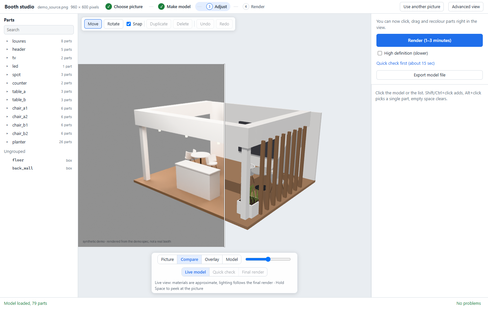

[English](README.md) · **简体中文**

# booth-image-to-model

**booth-image-to-model 把一张展台照片或效果图变成可编辑的参数化三维模型（JSON spec）、Blender 场景和干净的客户渲染图——可以作为 AI agent 的
skill 使用，也可以在本机网页工作台里使用。**

[](LICENSE)




*工作台的示例展台：分界线左边的合成图是用示例模型在它自己的机位渲染出来的，所以和右边的可编辑模型完全重合。真实图片得到的相机和尺寸是估计的拟合结果。（图片是本项目生成的合成图。）*

## 能做什么

- **输入**：一张展台图片（设计效果图或现场照片）。
- **输出**：以米为单位的参数化模型（`spec.json`：地台、墙、楣板、门架、柜台、家具、屏幕、灯，每个构件都能改）、`.blend` 文件、去掉展厅、邻展、
  Logo 和人物的客户渲染图、第二视角，以及任何三维查看器都能打开的 GLB。
- **怎么做**：agent 或大模型读图（角点、构件、颜色）；代码用角点拟合相机和比例，把每个构件反投影成米制尺寸，校验模型，再用 Blender 渲染。
  之后可以在浏览器编辑器里调整构件，再出图。
- **不是 CAD**：尺寸是从一张图估计的，每个假设都有记录，不能直接用于施工。

## 两种用法

| | **A. Agent skill** | **B. 网页工作台** |
|---|---|---|
| 适合 | 用编程 agent 工作的人（Claude Code、Codex、Cursor、Agent SDK 应用） | 想用窗口和按钮操作的设计师、销售 |
| 谁来读图 | 你的 agent，按 [`SKILL.md`](booth-image-to-model/SKILL.md) 执行 | 你配置的任何 OpenAI 兼容模型，或你上传的文件 |
| 需要 | Python 3.10+、依赖包；出图需要 Blender 4.0+ | Python 3.10+、依赖包、浏览器；出图需要 Blender 4.0+；自动读图需要 key |
| 说明 | [booth-image-to-model/README_CN.md](booth-image-to-model/README_CN.md) | [web/README.md](web/README.md)（英文） |

### A. 在 agent 里使用 skill

```bash
git clone https://github.com/ocrevo/booth-image-to-model.git
python3 -m venv .venv && . .venv/bin/activate              # Windows：py -3 -m venv .venv ; .venv\Scripts\activate
python -m pip install -r booth-image-to-model/booth-image-to-model/requirements.txt
mkdir -p ~/.claude/skills
cp -r booth-image-to-model/booth-image-to-model ~/.claude/skills/          # Claude Code；其他 agent 让它读 SKILL.md
python ~/.claude/skills/booth-image-to-model/scripts/boothctl.py doctor   # 列出依赖包和找到的 Blender
```

请在已激活这个 venv 的终端里启动 agent（或告诉 agent 用哪个 `python`），skill 的命令才能找到这些依赖包。然后在图片所在目录对 agent 说：“把 input/booth.jpg 生成三维模型和干净的渲染图。”

### B. 运行网页工作台

```bash
git clone https://github.com/ocrevo/booth-image-to-model.git && cd booth-image-to-model
python3 -m venv .venv && . .venv/bin/activate              # Windows：py -3 -m venv .venv ; .venv\Scripts\activate
python -m pip install -r booth-image-to-model/requirements.txt
python web/server/run.py                                  # 打开 http://127.0.0.1:8800/
```

还没有 key？在空白舞台点 **Try the demo booth**（试用示例展台），合成展台和它的模型会直接载入。自动读图需要设置 `OPENAI_API_KEY`（OpenAI；DeepSeek 用
`--provider deepseek`；任何 OpenAI 兼容服务都可以）。工作台和独立编辑器（`python web/tools/serve.py`）的界面都是英文。

## 环境要求

| | 版本 | 用于 |
|---|---|---|
| Python | 3.10+（已测 3.12） | 全部 |
| numpy、Pillow、SciPy、jsonschema、trimesh | 见 [requirements.txt](booth-image-to-model/requirements.txt) | 全部 |
| Blender | 4.0+（已测 5.2.2） | `.blend` 和渲染；通过 `BLENDER_EXE`、`PATH` 或常见安装位置查找 |
| 浏览器 | 新版 Chrome、Edge、Firefox 或 Safari | 工作台和编辑器 |
| 能读图片的 OpenAI 兼容服务的 key | 可选 | 工作台的自动读图 |
| Node.js | 22.15+ | 只用于网页测试 |

已在 Windows 10 上测试。代码支持 Linux 和 macOS（路径、Blender 查找、Python 调用），CI 在这两类系统上不带 Blender 运行测试；Linux 和 macOS
上的完整原生测试还不在发布证据里。

## 工作原理

```
图片 ──► 场景描述 ──► 拟合相机和比例 ──► 参数化 spec ──► Blender 构建 ──► 客户图、.blend、第二视角
(agent 或   (像素加        (角点，            (米制构件，        (新进程，            + GLB，+ 浏览器编辑器
 大模型)     普通数字)      box_fit)           已校验)            重新打开检查)
```

spec（[booth-spec-v2 schema](booth-image-to-model/schemas/booth-spec-v2.schema.json)）是唯一真源，浏览器编辑器、GLB 导出和 Blender 构建都读它。
场景描述（[schema](booth-image-to-model/schemas/scene-description.v1.json)）是“读图”和“编译”之间的交接格式，所以读图可以交给任何模型、agent、
脚本或人。

## 局限

- 只有一张图：看不见的侧面、准确尺寸和材质都是估计，并标明是估计。
- 读图质量取决于读图的 agent 或模型；相机拟合和叠加图会显示读错的地方。
- 还没有图纸（平面图、立面图在计划中）。浏览器里的文字和格网图案是示意。
- 工作台拒绝超过 500 万像素或带 EXIF 旋转信息的图片。

## 常见问题

**这是 CAD 工具吗？** 不是。它从一张图重建展台的造型和观感。尺寸是估计值并记录为假设，未经核实不能用于施工或物料清单。

**支持哪些 AI 模型？** skill：任何能看图、能运行命令的编程 agent（已用 Claude Code 测试）。工作台：任何模型能接收图片的 OpenAI 兼容服务；
内置 OpenAI 和 DeepSeek 预设，地址和模型都可以配置。

**一定要装 Blender 吗？** 只有 `.blend` 和渲染需要。读图、编译模型、浏览器编辑器和 GLB 导出都不需要。

**我的图片会被上传吗？** skill 不联网。工作台只有在你为这张图勾选同意后，才把它发给你配置的大模型服务；其余都留在你的电脑上。独立编辑器不上传
任何东西。详见 [SECURITY.md](SECURITY.md)。

**能在 Claude Code、Codex 或 Cursor 里用吗？** 能。把 `booth-image-to-model/` 复制到 Claude Code 的 skills 目录，或让其他 agent 读它的 `SKILL.md`。

**什么许可证？** Apache-2.0。第三方组件见 [THIRD_PARTY_NOTICES.md](THIRD_PARTY_NOTICES.md)。

## 文档

| 我想… | 看 |
|---|---|
| 在 agent 里安装 skill | [booth-image-to-model/README_CN.md](booth-image-to-model/README_CN.md) |
| 了解 agent 每一步做什么 | [booth-image-to-model/SKILL.md](booth-image-to-model/SKILL.md)（英文） |
| 运行工作台或编辑器、配置模型 | [web/README.md](web/README.md)（英文） |
| 手写场景描述 | [references/scene-description.md](booth-image-to-model/references/scene-description.md) |
| 了解 spec 格式 | [references/data-contract.md](booth-image-to-model/references/data-contract.md) 和 [schema](booth-image-to-model/schemas/booth-spec-v2.schema.json) |
| 参与贡献 | [CONTRIBUTING.md](CONTRIBUTING.md)，编程 agent 看 [AGENTS.md](AGENTS.md) |
| 报告安全问题 | [SECURITY.md](SECURITY.md) |
| 版本记录 | [CHANGELOG.md](booth-image-to-model/CHANGELOG.md) |

**名词**：*skill*：agent 执行的目录 `booth-image-to-model/`。*工作台*：本机网页应用（`web/server/run.py` + `studio.html`）。*编辑器*：独立的浏览器
编辑器（`web/app/index.html`）。*spec*：参数化模型（`spec.json`）。*场景描述*：从图上读出的内容，像素加普通数字（`scene.json`）。

## 项目

仓库已从 `Booth2CAD` 改名为 `booth-image-to-model`，旧链接会自动跳转。当前版本 3.1.0-rc7。欢迎按 [Apache License 2.0](LICENSE)
贡献；请先读 [CONTRIBUTING.md](CONTRIBUTING.md)，不要附带客户图片。引用本项目请用 [CITATION.cff](CITATION.cff)。
