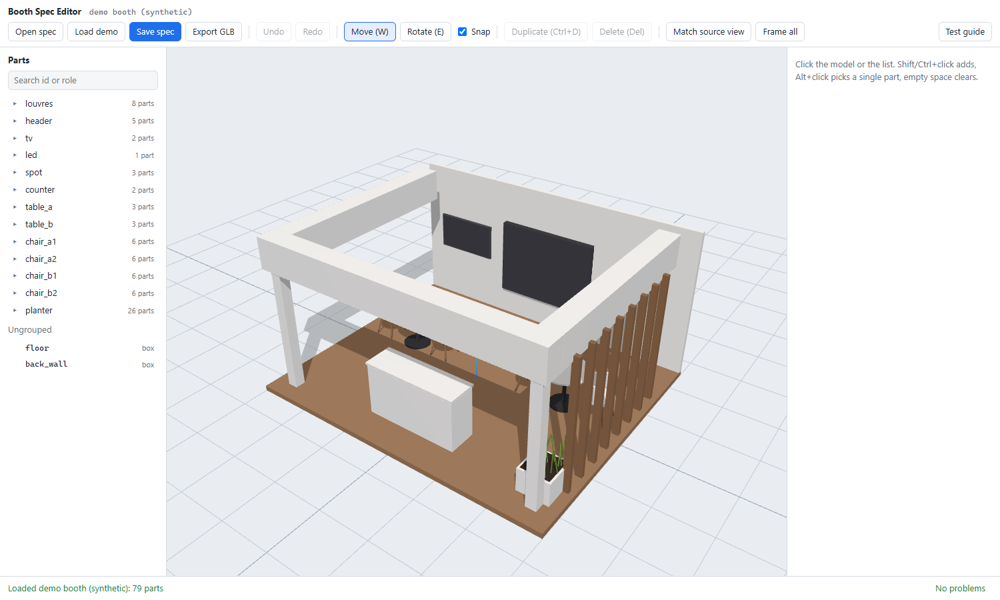

# Web studio and spec editor

The web side of [booth-image-to-model](../README.md). Two pages, one folder:

- **The studio** (`studio.html`, needs the local server): one window from a booth picture to an editable model and a clean
  render. ① 选图 (choose a picture) → ② 生成模型 (make the model) → ③ 调整 (adjust) → ④ 出图 (render). The UI is in Chinese.
- **The standalone editor** (`index.html`, no server): opens a `spec.json`, lets you move, turn, recolour, resize and
  duplicate parts, and exports GLB. Everything stays in your browser; nothing is uploaded. Chinese and English UI.


## Run the studio

Requirements: Python 3.10+, the engine's Python packages, a current browser. Optional: Blender 4.x+ (5.2.2 tested) for renders and
`.blend` files; a key for an OpenAI-compatible service for automatic reading.

```bash
# from the repository folder
python3 -m venv .venv && . .venv/bin/activate        # Windows: py -3 -m venv .venv ; .venv\Scripts\activate
python -m pip install -r booth-image-to-model/requirements.txt
python web/server/run.py                             # opens http://127.0.0.1:8800/
```

`run.py` names any missing package and stops. It prints where it found Blender (or that it did not), and whether a key is set.

**Try it without a key:** on the empty stage click **试用示例展台** ("try the demo booth"). It loads a synthetic booth picture and its
model, so you can adjust, compare and render at once. The demo and screenshot pictures are synthetic ([docs/sample-images.md](../docs/sample-images.md)).

**With your own picture:** drop it on the stage (PNG or JPEG, ≤ 25 MB, ≤ 5 MP, no EXIF rotation). Then either:
- tick the consent box and click **生成模型** (needs a key, see below), or
- open **更多方式** ("more ways") and upload a scene description you wrote (`scene.json`, format in
  [`references/scene-description.md`](../booth-image-to-model/references/scene-description.md)), or a `spec.json` made for this picture.

What each step does underneath:

| Step | You | Underneath |
|---|---|---|
| ① 选图 | drop or choose a picture | stored in `output/studio/<job>/` (git-ignored) |
| ② 生成模型 | consent + "生成模型", or upload a file | a large model reads the picture into a scene description; the engine fits the camera from corner points and builds the parametric spec |
| ③ 调整 | click, drag, recolour on the stage; compare with the picture (wipe, overlay, picture alone, model; hold Space to peek) | every change is saved 0.8 s later |
| ④ 出图 | "出图", optionally a 15-second quick check first | Blender renders the client picture and a second view; the `.glb` is exported; downloads and "open in Blender" appear |

The card on the right always names the one next action. Engineering details are in **专业视图** ("professional view"): the fit
overlay, corner errors, Blender's four-pane check sheet, dropped and assumed parts, design hints and every step's log.

## Automatic reading with a large model

Any OpenAI-compatible service that accepts images works. The call is plain HTTP in `server/reader_openai.py`; there is no SDK.
The reply is checked with the same validator the compiler uses and sent back for at most two repairs.

```bash
export OPENAI_API_KEY=...                      # or paste the key on the page; it stays in the server's memory only
python web/server/run.py                       # OpenAI: Responses API, model gpt-5.5, strict JSON schema
python web/server/run.py --provider deepseek   # DeepSeek: https://api.deepseek.com, model deepseek-flash, JSON mode
```

| Setting | Flag | Environment variable | Default |
|---|---|---|---|
| Provider preset | `--provider openai\|deepseek` | `LLM_PROVIDER` | `openai` |
| API key | (page) | `OPENAI_API_KEY` | none: reading is off |
| Base URL | `--openai-base-url` | `OPENAI_BASE_URL` | from the preset |
| Model | `--openai-model` | `OPENAI_MODEL` | from the preset |
| Request style | `--openai-style responses\|chat\|chat-json` | `OPENAI_API_STYLE` | from the preset |
| Reasoning effort | `--openai-effort` | `OPENAI_REASONING_EFFORT` | not sent |
| Output token limit | `--openai-max-output-tokens` | `OPENAI_MAX_OUTPUT_TOKENS` | 32000 |
| Blender | | `BLENDER_EXE` | found on `PATH` or the usual install folders |
| Port, jobs folder | `--port`, `--jobs-dir` | | 8800, `output/studio` |

Styles: `responses` is the OpenAI Responses API. `chat` is Chat Completions with a strict JSON schema. `chat-json` is Chat
Completions for services that only offer JSON mode (DeepSeek and many local servers): the schema goes into the instructions, and
the validator plus the repairs enforce it.

The presets follow each provider's published API. In this repository they are tested against a local stand-in
(`tests/mock_openai.py`), not against the live services. If a service refuses the output limit, lower `OPENAI_MAX_OUTPUT_TOKENS`.

## Privacy and safety

- The server listens on `127.0.0.1` only, refuses other web pages (Host and Origin checks), and has **no login**: it is a
  single-user tool. To use it from another computer of yours, tunnel it: `ssh -L 8800:127.0.0.1:8800 you@that-machine`.
- A picture goes to the large-model service only after you tick the consent box for that picture, and only to the service you
  configured. The key is never written to disk. Details: [SECURITY.md](../SECURITY.md).

## Limits and safeguards

- Pictures over 5 MP are refused, because Blender renders at the picture's size and a larger frame ran the denoiser out of memory.
- Pictures with an EXIF rotation tag (common for phone photos) are refused: the browser shows them upright while the pixels are
  sideways. Save the picture again without the tag.
- A job refuses edits and uploads while one of its steps runs; an edit made meanwhile is saved when the step ends.
- After a server restart, steps that were running show as errors.
- The live model in the browser is schematic (no reflections, simplified text and patterns). The rendered pictures show the real
  light and materials.
- Reading quality depends on the model you use. The professional view shows how well the camera fit, so a bad reading is visible
  before anything is built.

## The standalone editor

```bash
python web/tools/serve.py          # http://127.0.0.1:8000/ ; opening index.html from disk does not work (ES modules)
```



It loads the synthetic demo booth; "打开 spec / Open spec" opens your own. Edited parts are marked `inferred` with the note "Edited in
the web editor", and the camera is marked `unfitted`. Check the result with `validate_spec.py --check-source` before rebuilding.

**Static hosting:** `app/index.html` with `app/js`, `app/css`, `app/vendor` and `app/demo` works on any static host (for example
GitHub Pages) and makes no network calls except loading the demo from the same site. `studio.html` needs the local server and does
not work on a static host.

## Layout

| Folder | What | Served? |
|---|---|---|
| `app/` | `studio.html`, `index.html`, `js/`, `css/`, vendored `vendor/three/`, synthetic `demo/` | yes, the deploy root |
| `server/` | the local studio server: `run.py`, `server.py` (HTTP), `jobs.py`, `steps.py`, `engine.py` (the only file that touches the skill), `reader_openai.py`, `grid.py`, `prompts/` | no |
| `tests/` | `node --test` suites, Python server and reader tests, a stand-in for the OpenAI API, headless-browser smoke tests | no |
| `tools/` | `serve.py` (static preview), `make_demo.py` (rebuilds the synthetic demo), `py.mjs` (runs Python the same way on every OS) | no |

How the editor works: the spec is the single source of truth. `js/geometry.js` and `js/camera.js` are line-for-line ports of the
skill's `geometry.py` and `camera_math.py`, and parity tests compare them with Python. Z is up, and Euler angles use Blender's order
(three.js `ZYX`). Parts that share a `group` move together. GLB export makes one node per part with `group:<name>` parents and is Y-up.

## Checks

Node.js 22.15+ is needed for the tests only. The Python tests use `$PYTHON` (default `python3`, or `python` on Windows). The smoke
tests use Chrome, Chromium or Edge (`--chrome <path>` or `$CHROME`).

```bash
cd web
npm test              # geometry and camera parity with Python, edit operations, the studio's decisions and wording
npm run test:server   # every studio step through the real HTTP API; the reader against a stand-in (set BLENDER_EXE for renders)
npm run smoke         # headless browser drives the standalone editor
npm run smoke:studio  # headless browser drives the studio end to end (Blender steps when Blender is found)
python tests/make_geometry_reference.py   # after changing geometry.py
python tools/make_demo.py [--render]      # after changing the macros; --render re-renders the demo picture with Blender
```

## Third-party

three.js 0.186.1 (MIT) is vendored unmodified under `app/vendor/three/` (see `VERSION.txt` and `LICENSE` there, and
[THIRD_PARTY_NOTICES.md](../THIRD_PARTY_NOTICES.md)).
